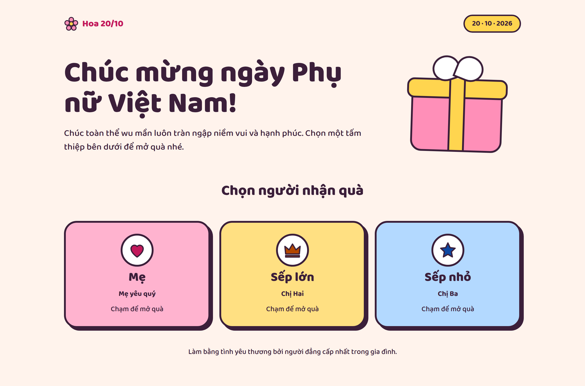

# Vietnamese Women's Day Card

An interactive greeting card page for Vietnamese Women's Day (October 20). Pick a recipient to open a personalized card with coin-drop and confetti animations.

**Live demo:** [math-self.github.io/vietnamese-womens-day-card](https://math-self.github.io/vietnamese-womens-day-card/)

## Tech

Vanilla HTML, CSS and JavaScript in a single `index.html`. No build step or dependencies.

## Run locally

Open `index.html` in a browser.

## Customize

Recipients are defined in the `people` array in the `<script>` block of `index.html`.

## Deploy

Served with GitHub Pages from the `main` branch (root). If you rename the repo or use a custom domain, update the `og:url` and `og:image` URLs in `index.html`.
